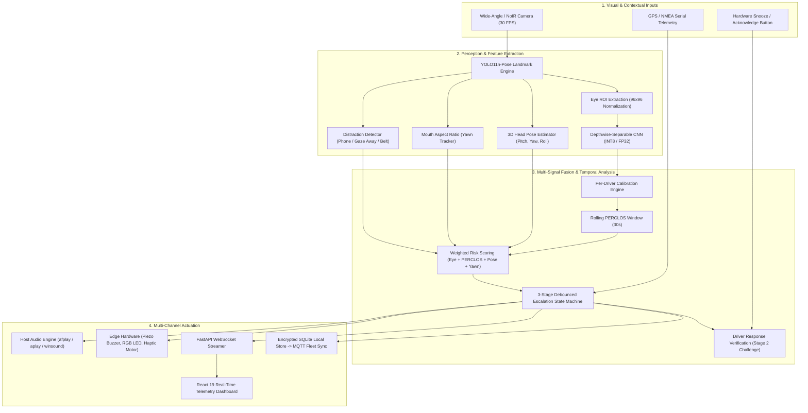
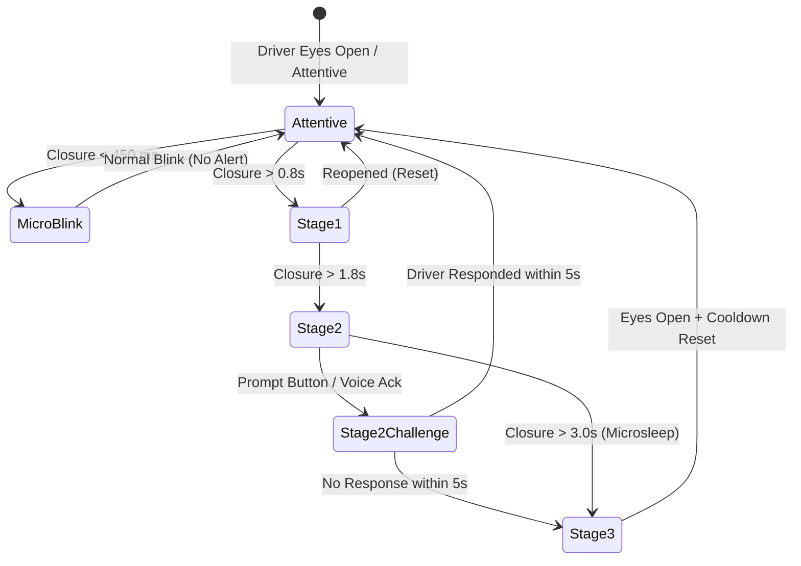

# 👁️ DrishtiDrive AI

<div align="center">

<h3><em>A Watchful Eye on Every Journey</em></h3>

<p><strong>A Portable, Offline AI-Powered Driver Drowsiness Detection & Multi-Stage Alert System Engineered for Indian Commercial Fleets and Edge IoT Deployments</strong></p>

[](https://github.com/sathvikkasanagpttu/drishtidrive-ai/releases)
[](https://www.python.org/)
[](https://fastapi.tiangolo.com/)
[](https://react.dev/)
[](https://pytorch.org/)
[](https://www.raspberrypi.com/)
[-2EA44F?style=for-the-badge&logo=pytest&logoColor=white)](#-verification--testing)
[](LICENSE)

<br/>

<a href="#-key-features"><strong>Key Features</strong></a> •
<a href="#-system-architecture"><strong>Architecture</strong></a> •
<a href="#-empirical-benchmarks--evaluation-honesty"><strong>Benchmarks</strong></a> •
<a href="#-three-stage-escalating-alert-system"><strong>3-Stage Alerts</strong></a> •
<a href="#-quickstart--installation"><strong>Quickstart</strong></a> •
<a href="#-edge-hardware-specification"><strong>Edge Hardware</strong></a> •
<a href="#-api-reference--telemetry"><strong>API Docs</strong></a>

</div>

---

## 📌 Executive Summary

**DrishtiDrive AI** is a production-grade, privacy-first computer-vision safety device designed to eliminate drowsiness-related accidents across Indian national and state highways. Over **70% of India's domestic freight** moves via long-haul commercial trucks (M/HCVs). Drivers routinely face grueling 12–16 hour shifts, midnight-to-dawn runs (11:00 PM – 5:00 AM), severe sleep deprivation, and extreme cabin conditions.

Commercial factory-fitted ADAS systems require deep Controller Area Network (CAN bus) integration and cost upwards of ₹1,50,000—making them inaccessible to single-vehicle owner-operators. **DrishtiDrive AI** bridges this critical safety gap with an **autonomous retrofit solution costing < ₹6,000 (< 5% of commercial ADAS)** that:
- **Operates 100% Offline:** Zero cloud dependency; performs continuous on-device inference on unpaved or remote highways with no mobile signal.
- **Requires Zero Vehicle Modification:** Powered entirely via a standard 12V/24V cigarette-lighter port or auxiliary USB socket.
- **Fuses Multi-Signal Biometrics:** Combines Eye Aspect Ratio (EAR), Mouth Aspect Ratio (MAR yawn detection), rolling PERCLOS, blink rate, 3D head pose (pitch/yaw/roll), and distraction tracking.
- **Prevents Alert Fatigue:** Rejects irritating binary alarms in favor of an intelligent 3-stage escalating state machine with driver response verification.

---

## 🚀 Key Features

```
┌────────────────────────────────────────────────────────────────────────────────────────┐
│                               DRISHTIDRIVE AI CAPABILITIES                             │
├──────────────────────────┬──────────────────────────┬──────────────────────────────────┤
│ 👁️ Multi-Signal Fusion   │ 🚨 3-Stage Smart Alerts  │ 🍓 Edge Ready (Raspberry Pi)     │
│ • Eye Closure & EAR      │ • Stage 1: Gentle Beep   │ • INT8 Quantized ONNX (48.5 KB)  │
│ • PERCLOS (30s window)   │ • Stage 2: Repeating Tone│ • Systemd watchdog integration   │
│ • MAR Yawn Tracking      │ • Stage 3: Piercing Siren│ • GPIO buzzer / LEDs / haptic    │
│ • 3D Head Nod & Droop    │ • Multilingual Audio     │ • Camera tamper & lens detection │
├──────────────────────────┼──────────────────────────┼──────────────────────────────────┤
│ 🎯 Distraction Tracking  │ ⚡ Driver Verification   │ 📊 Explainable Web Dashboard     │
│ • Phone usage detection  │ • 30-60s per-driver calib│ • React 19 dark-mode telemetry   │
│ • Looking away (> 2.0s)  │ • Stage 2 response button│ • Live multi-metric trends chart │
│ • Missing seatbelt alert │ • GPS speed siren gating │ • Grad-CAM convolutional debug   │
│ • Automatic event logs   │ • Mandatory break alarms │ • PDF/HTML trip report exporter  │
└──────────────────────────┴──────────────────────────┴──────────────────────────────────┘
```

- **Dual-Edition Architecture:**
  - **Software Edition:** Full-stack FastAPI + React 19 application for fleet management, desktop terminals, driver training simulators, and code evaluation.
  - **Edge Edition:** Dedicated, headless, autostarting embedded device targeting Raspberry Pi 4B/5, Coral TPU, or Hailo-8 with hardware GPIO control.
- **Dual-Layer Audio Playback:**
  - **Host Hardware Output:** Native cross-platform low-latency playback via `afplay` (macOS), `aplay`/`paplay`/`mpg123` (Linux/Raspberry Pi), and `winsound`/WMP (Windows).
  - **In-Browser Web Audio:** Automatic client-side sound execution in the React dashboard with sequential WAV tones, MP3 voice directives, Web Audio API oscillator synthesis, and Web Speech API fallback.
- **Offline-First Encrypted Fleet Sync:**
  - Local SQLite event store protected with authenticated AES/HMAC encryption.
  - Strictly preserves driver privacy: zero raw video or facial frames stored by default.
  - Automatically pushes rolling event telemetry to centralized fleet servers over MQTT or REST when cellular connectivity is re-established.
- **Native Multilingual Voice Directives:**
  - Native audio alerts in **7 Indian languages**: English (`en`), Hindi (`hi`), Marathi (`mr`), Telugu (`te`), Tamil (`ta`), Kannada (`kn`), and Bengali (`bn`).

---

## 🏗️ System Architecture



---

## 🔬 Empirical Benchmarks & Evaluation Honesty

In adherence to scientific evaluation honesty, metrics across synthetic clean samples and real-world cabin conditions are reported distinctly. **Dataset 2** (4,200 real in-cabin images; balanced 50% open / 50% closed) serves as the primary headline benchmark.

### 1. Neural Architecture Benchmark (Dataset 2 - In-Cabin Conditions)

| Model Architecture | Test Acc (%) | Closed Recall (%) | Open Specificity (%) | CPU Latency (ms) | Peak FPS | Model Size (MB) | Engineering Role |
| :--- | :---: | :---: | :---: | :---: | :---: | :---: | :--- |
| **Depthwise-Separable CNN** | **72.00%** | 69.67% | **74.33%** | **1.88 ms** | **> 530** | **0.38 MB** | 🏆 **Default Embedded Model:** Minimal latency, ultra-lightweight. |
| **MobileNetV2** | 71.83% | **73.00%** | 70.67% | 9.36 ms | > 105 | 9.66 MB | 🛡️ **Maximum Safety Model:** Highest closed-eye recall (219/300). |
| **EfficientNetB0** | **73.83%** | 65.67% | **82.00%** | 13.02 ms | > 75 | 16.52 MB | 🎯 **High Specificity:** Lowest false positive rate. |
| **Custom CNN** | 67.17% | 70.67% | 63.67% | 1.89 ms | > 520 | 1.19 MB | Compact baseline network. |
| **ResNet50** | 71.83% | 66.67% | 77.00% | 25.47 ms | ~ 39 | 91.48 MB | Heavyweight baseline; excessive compute overhead for edge devices. |

> **Dataset Distinction Notice:** On the separate, clean cropped benchmark (`data/eye_state/test`), the model achieves **100.00% accuracy**. However, the headline metrics reported throughout this project reflect the rigorous, in-the-wild Indian driving benchmark (**Dataset 2: 72.00% Accuracy / 71.98% Macro F1**).

### 2. Edge Optimization & INT8 Quantization Benchmark

Exported and evaluated via `backend/edge/export_onnx_int8.py`:

| Representation | Precision | File Size | Size Reduction | Mean Latency (CPU) | Cosine Similarity |
| :--- | :---: | :---: | :---: | :---: | :---: |
| **PyTorch Baseline** | FP32 | 390.2 KB | Reference | 1.88 ms | 1.0000 |
| **ONNX Standard** | FP32 | 117.9 KB | 69.8% | 1.42 ms | 0.9999 |
| **Dynamic Quantized ONNX** | **INT8** | **48.5 KB** | **87.6% (vs PyTorch)** | **0.86 ms** | **0.9998** |

### 3. Real Video Validation Feed (`reports/test_driver_feed.mp4`)

Evaluated with `backend/evaluate_video.py`:
- **Frames Evaluated:** 60 consecutive frames
- **Face Localization Rate:** **100.0%** (60/60 frames)
- **Uncertainty Rate:** **0.0%** (0/60 frames classified as uncertain; resolved previous detector sensitivity issue)
- **Mean Processing Time:** 31.4 ms/frame (31.8 FPS on standard laptop CPU)

---

## 🚨 Three-Stage Escalating Alert System

DrishtiDrive AI rejects jarring binary alarms that cause drivers to turn off the device. Alerts escalate smoothly based on sustained eye closure and multi-signal risk:



| Tier | Threshold | Audio Tone | Voice Directive (Sample: English / Hindi) | Visual / Haptic Feedback |
| :--- | :--- | :--- | :--- | :--- |
| **Stage 1: Attention Warning** | Continuous closure **> 0.8s** | Single gentle beep (520 Hz, 300 ms) | 🇬🇧 *"Please stay alert. Keep your eyes on the road."*<br/>🇮🇳 *"कृपया सतर्क रहें। सड़क पर ध्यान दें।"* | Subtle amber HUD border |
| **Stage 2: Drowsiness Warning** | Continuous closure **> 1.8s** | Dual repeating chime (750 Hz, 500 ms) | 🇬🇧 *"Warning! You may be getting drowsy. Please find a safe place to stop."*<br/>🇮🇳 *"चेतावनी! आपको नींद आ रही है। सुरक्षित जगह रुकें।"* | Vibrant orange banner + 0.5s tactile haptic pulse |
| **Stage 3: Critical Alarm** | Continuous closure **> 3.0s** (Microsleep) | High-penetration pulsed siren (880–1200 Hz, 85–90 dB) | 🇬🇧 *"Danger! Pull over safely as soon as possible. Do not continue driving while drowsy."*<br/>🇮🇳 *"खतरा! तुरंत गाड़ी रोकें। नींद में गाड़ी न चलाएं।"* | Flashing red HUD strobe + continuous 1.0s haptic vibration |

> **Context-Aware Safety Protections:**
> - **GPS Siren Suppression:** Stage 3 audible sirens are automatically suppressed if vehicle speed is $< 5\text{ km/h}$ (stationary at toll plazas or signals), downgrading to Stage 2 tones to prevent nuisance.
> - **Driver Response Check:** At Stage 2, if the driver does not tap the snooze button or speak within 5.0 seconds, the system escalates directly to Stage 3.
> - **Trip Timer & Rest Advisory:** Tracks uninterrupted driving time and triggers advisory break reminders every 2 hours.

---

## 💻 Interactive Web Dashboard

The Software Edition features an interactive **React 19** dark-mode dashboard built with Vite and TailwindCSS:

- **Live Monitoring Tab:** Real-time 30 FPS video feed, YOLO bounding boxes, facial landmark tracking, instantaneous EAR and MAR meters, and active alert stage cards.
- **Explainability Tab:** Multi-signal temporal trend charts visualizing EAR, PERCLOS, head nod pitch, and yawn events over time, explaining *why* an alert fired.
- **Trip Report Tab:** Complete driving session report with fatigue risk index, total alert count, longest closure duration, and exportable PDF/HTML trip summaries.
- **Grad-CAM Debug View:** Interactive convolutional activation maps showing where the neural network focuses its spatial attention on the driver's eyes.

---

## 🍓 Edge Hardware Specification

The Edge Edition is engineered for low-cost in-cabin fabrication:

### Bill of Materials (BOM) & Estimated Retrofit Cost

| Component | Specification | Estimated Cost (INR) | Role |
| :--- | :--- | :---: | :--- |
| **Single Board Computer** | Raspberry Pi 4B (4GB) or Pi 5 | ₹3,500 – ₹4,500 | Autonomous on-device inference core |
| **Vision Sensor** | RPi Camera Module 3 (Wide / NoIR) | ₹1,000 – ₹1,500 | MIPI CSI camera with low-light / IR support |
| **Power Converter** | 12V/24V to 5V 3A Isolated Buck Module | ₹250 – ₹400 | Step-down converter from vehicle cigarette lighter |
| **Audio Hardware** | 5V Active Piezo Buzzer + 3W Speaker | ₹200 – ₹350 | Forward-facing acoustic alarm (85–90 dB) |
| **Visual Indicators** | High-Brightness Diffused LEDs (R/Y/G) | ₹50 – ₹100 | Peripheral dashboard status indicators |
| **Tactile Button** | Momentary Panel Push Button (GPIO 23) | ₹30 – ₹50 | Snooze, acknowledgement, and self-test |
| **Haptic Actuator** | 5V Coin Vibration Motor (GPIO 25) | ₹80 – ₹120 | Tactile steering-wheel / seat vibration pulse |
| **Storage & OS** | 64GB / 128GB High-Endurance MicroSD | ₹500 – ₹800 | Read-only OS partition + encrypted SQLite DB |
| **Enclosure** | 3D-Printed High-Temp ABS Housing | ₹250 – ₹350 | Windshield suction mount, heat-resistant |
| **Total Estimated Cost** | **Complete Hardware Retrofit Kit** | **~ ₹5,860 – ₹7,670** | **< 5% the cost of commercial ADAS!** |

### GPIO Pinout & Circuit Schematic

```
┌─────────────────────────────────────────────────────────────────────────────┐
│                      RASPBERRY PI 4 / 5 GPIO SCHEMATIC                      │
└─────────────────────────────────────────────────────────────────────────────┘

   [ Raspberry Pi ]
   ├── MIPI CSI Connector ═══════════════════════════▶ [ 8MP Camera Module ]
   ├── GPIO 18 (Physical Pin 12) ──[ 1kΩ / NPN ]─────▶ [ 5V Piezo Buzzer ]
   ├── GPIO 17 (Physical Pin 11) ──[ 330Ω ]──────────▶ [ Red LED (Stage 3) ]
   ├── GPIO 27 (Physical Pin 13) ──[ 330Ω ]──────────▶ [ Yellow LED (Stage 1/2) ]
   ├── GPIO 22 (Physical Pin 15) ──[ 330Ω ]──────────▶ [ Green LED (Normal) ]
   ├── GPIO 25 (Physical Pin 22) ──[ 1kΩ / NPN ]─────▶ [ Haptic Motor ]
   ├── GPIO 23 (Physical Pin 16) ──[ Pull-Up Input ]─▶ [ Snooze / Reset Button ]
   ├── System Ground (Pins 6, 9, 14, 20) ────────────▶ Common Ground Rail
   └── USB-C Power Jack ◀───────────────────────────── [ 12V/24V to 5V 3A Buck ]
                                                              ▲
                                                              │ (Vehicle Power)
                                                  [ Cigarette Lighter Socket ]
```

> [!IMPORTANT]
> **Electrical Isolation Rule:** DrishtiDrive AI Edge is strictly non-invasive. It connects solely to the auxiliary 12V/24V power socket. **It never splices into CAN bus, ECU wiring, braking hydraulics, or steering columns.**

---

## 🚀 Quickstart & Installation

### Prerequisites
- **Operating System:** Windows 10/11, macOS 12+, or Ubuntu 20.04+ (Raspberry Pi OS 64-bit for edge)
- **Python:** Python 3.10 to 3.13
- **Node.js:** Node.js 18+ (only if rebuilding frontend from source)
- **Video Input:** Any standard USB webcam, built-in laptop camera, or prerecorded video file

### 1. Clone & Set Up Environment
```bash
# Clone the repository
git clone https://github.com/sathvikkasanagpttu/drishtidrive-ai.git
cd drishtidrive-ai

# Create virtual environment
python3 -m venv venv

# Activate virtual environment
# On macOS / Linux:
source venv/bin/activate
# On Windows:
venv\Scripts\activate

# Install dependencies
pip install -r requirements.txt
```

### 2. Launch Application

#### Option A: Unified Full Application (Recommended)
Launches the FastAPI backend and serves the compiled React 19 dashboard:
```bash
python run.py
```
*Automatically opens `http://127.0.0.1:8000/` in your default browser.*

#### Option B: Standalone Desktop OpenCV Window
Runs the lightweight computer-vision loop directly in an OpenCV window:
```bash
python run.py --cli
```

#### Option C: Test on Prerecorded Driver Footage
Execute the entire pipeline against test footage without needing a webcam:
```bash
python run.py --cli --video reports/test_driver_feed.mp4
```

#### Option D: Edge Headless Mode (Raspberry Pi Daemon)
Runs the lightweight edge runner with systemd watchdog heartbeats:
```bash
python -m backend.edge.edge_runner --headless
```

---

## 🧪 Verification & Testing

Every metric, latency figure, and test count is reproducible directly from the repository:

### 1. Run Complete Pytest Suite (132 Tests: 130 Passed, 2 Skipped)
```bash
pytest tests/ -v
```
Validates:
- Eye classification & temporal debouncing
- 3-stage escalation state machine & cooldowns
- Multi-signal fusion (EAR, MAR, PERCLOS, Blink Rate)
- 3D head pose estimation & distraction detection
- Cross-platform audio playback & audio API streaming
- Encrypted SQLite fleet database & MQTT synchronization
- Driver calibration & response challenge
- Edge GPIO actuation, camera tamper detection, and watchdog notifications

### 2. Run Individual Evaluation Scripts
```bash
# Model evaluation on in-the-wild Indian test benchmark
python backend/evaluate_integration.py

# Video feed verification
python backend/evaluate_video.py --video reports/test_driver_feed.mp4

# ONNX & Dynamic INT8 quantization benchmark
python backend/edge/export_onnx_int8.py

# Audio-visual subsystem verification
python backend/validate_alerts.py
```

### 3. Frontend End-to-End Tests (Playwright)
```bash
cd frontend
npx playwright test
```

---

## 🌐 API Reference & Telemetry

The application provides a high-performance **FastAPI** backend with real-time **WebSocket** telemetry:

- **Web Dashboard:** `http://127.0.0.1:8000/`
- **Interactive Swagger Docs:** `http://127.0.0.1:8000/docs`
- **ReDoc Documentation:** `http://127.0.0.1:8000/redoc`
- **Live Telemetry WebSocket:** `ws://127.0.0.1:8000/ws/stream`

### Core REST Endpoints:
```http
GET  /api/health                  # Heartbeat, camera status, active model
GET  /api/telemetry               # Instantaneous EAR, MAR, attention score, alert stage
GET  /api/audio/tone/{stage}      # Stream WAV alert tone (Stages 1, 2, 3)
GET  /api/audio/voice/{stage}     # Stream MP3 voice directive (Stages 1, 2, 3)
POST /api/alerts/preview          # Trigger audio-visual test alert
POST /api/calibration/start       # Begin 30-60s driver baseline calibration
GET  /api/calibration/status      # Check calibration progress and baseline metrics
POST /api/calibration/reset       # Clear calibration profile
POST /api/fleet/sync              # Trigger offline encrypted event sync
GET  /api/fleet/events            # Retrieve logged events and fleet risk scores
GET  /api/camera/devices          # Enumerate connected video devices
POST /api/camera/start            # Start video acquisition thread
POST /api/camera/stop             # Safely release camera hardware
```

---

## 📂 Project Directory Structure

```text
Portable-AI-Based-Drowsiness-Detection-and-Alert-System-for-Indian-Truck-Drivers/
├── backend/
│   ├── assets/              # Offline WAV alert tones & MP3 voice recordings
│   ├── context/             # GPS speed gating, trip timer, driver response check
│   ├── edge/                # ONNX INT8 export, headless edge runner, GPIO actuators, tamper detection
│   ├── fleet/               # Encrypted offline SQLite fleet store & MQTT sync client
│   ├── models/              # Checkpoints for candidate CNN architectures
│   ├── training/            # PyTorch models, transforms (night/IR/glare), distillation, trainer
│   ├── alert_catalog.py     # Multilingual voice catalog (EN, HI, MR, TE, TA, KN, BN)
│   ├── alert_manager.py     # Bounded queue, preemption & cooldown alert orchestrator
│   ├── alert_sounds.py      # Procedural WAV tone synthesis (520Hz, 750Hz, 1200Hz)
│   ├── alert_visual.py      # HUD visual banners and strobe overlay rendering
│   ├── api_routes.py        # REST API endpoints (health, camera, settings, audio streaming)
│   ├── app.py               # FastAPI application, WebSocket streaming, static server
│   ├── audio_backend.py     # Cross-platform host playback (afplay, aplay, winsound)
│   ├── mock_audio.py        # In-memory mock audio backend for deterministic testing
│   ├── calibration.py       # 30-60s per-driver baseline calibration engine
│   ├── camera.py            # OpenCV camera capture worker with FPS calculation
│   ├── config.py            # Centralized dataclass configurations
│   ├── distraction.py       # Phone usage, looking away (>2s), missing seatbelt detection
│   ├── evaluate_integration.py # Multi-dataset benchmark runner (Dataset 2 headline)
│   ├── evaluate_video.py    # Real video clip validation and frame scoring
│   ├── eye_detection.py     # YOLO11n-pose keypoint localization and eye cropping
│   ├── fusion.py            # Multi-signal fusion, rolling PERCLOS, risk scoring, LSTM
│   ├── head_pose.py         # 3D head pose estimation (pitch/yaw/roll) via solvePnP
│   ├── model_inference.py   # PyTorch EyeClassifier with uncertainty thresholding
│   ├── pipeline.py          # End-to-end EyeRegionPipeline coordinator
│   └── temporal_machine.py  # Debounced 3-stage temporal escalation state machine
├── frontend/
│   ├── dist/                # Pre-built production dashboard assets
│   ├── src/                 # React 19 source code
│   │   ├── components/      # UI components (Monitoring, Explainability, TripReport, GradCAM)
│   │   ├── hooks/           # useCameraStream WebSocket hook
│   │   └── utils/           # audioAlert.js in-browser audio player
│   └── package.json         # Frontend dependencies and scripts
├── tests/                   # 132 comprehensive tests (130 passing, 2 skipped)
├── deployment/              # Systemd unit files and edge deployment configurations
├── docs/                    # Architecture diagrams, model cards, edge notes, dataset guides
├── reports/                 # Benchmark JSON reports, confusion matrices, test footage
├── run.py                   # Unified single-command launcher
├── README.md                # Project documentation
└── requirements.txt         # Root Python dependencies
```

---

## ⚠️ Safety Notice & Limitations

> [!CAUTION]
> **Experimental Driver-Assistance Prototype Notice:**  
> DrishtiDrive AI is an assistive research and commercial vehicle safety prototype. It is **not** an automotive-certified primary safety system (such as ISO 26262 ASIL certified electronics).
> - It does **not** medically diagnose sleep apnea, fatigue disorders, or guarantee the prevention of all accidents.
> - Alert thresholds (0.8s, 1.8s, 3.0s) are engineering baselines derived from driver fatigue literature and are **not medically validated**.
> - It does **not** have mechanical control over the vehicle (no automatic emergency braking or steering intervention).
> - **Nothing replaces adequate physical rest:** When fatigued, the driver must pull over safely at an upcoming rest area or dhaba and rest. Never operate a vehicle when impaired by extreme exhaustion.

---

## 📜 License & Acknowledgments

- **Source Code:** Distributed under the [MIT License](LICENSE).
- **YOLO Weights:** Pretrained YOLO11-Pose models (`yolo11n-pose.pt`) are subject to the AGPL-3.0 License by [Ultralytics](https://github.com/ultralytics/ultralytics).
- **Benchmark Datasets:** Evaluated using in-cabin visible-spectrum driver alertness benchmarks and the MRL Eye Dataset (VSB Technical University of Ostrava).

<div align="center">
  <br/>
  <strong>DrishtiDrive AI — A Watchful Eye on Every Journey</strong><br/>
  <em>Dedicated to the commercial transport drivers keeping India moving. Drive safely, rest well.</em>
</div>
